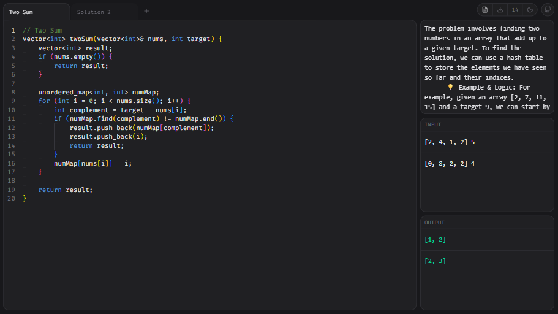

# 🚀 WhileCode: The Ultimate Competitive Programming IDE



**WhileCode** is an elite, AI-powered competitive programming workspace engineered specifically for high-performance algorithm solving and logic mastery. Designed around instant execution, strict memory limits, and seamless test-case management, it transforms standard algorithmic grinding into a lightning-fast premium experience with deep C++ runtime support.

[](https://nextjs.org/)
[](https://reactjs.org/)
[](https://tailwindcss.com/)
[](https://github.com/suren-atoyan/monaco-react)
[](https://groq.com/)

---

## ✨ Features & Highlights

### ⚡ Professional CP Runtime
- **LeetCode Template Injection**: An industrial-strength C++ wrapper that transparently parses and processes notoriously tricky structs like `ListNode` and `TreeNode` out of the box.
- **Contest-Ready I/O**: Custom `read<T>` helpers inherently resolve arrays, matrices, and tightly-packed complex delimiters automatically.
- **Object-Oriented Harness**: Smartly detects standalone function questions versus stateful class queries (e.g., LRU Cache) and dynamically mocks the respective sequence of commands.

### 🤖 The Elite Algorithm Mentor
- **Expert Problem Analyst**: Integrated with the **Groq SDK**, our AI mimics high-rated Codeforces logic to guide without handing out the raw answers.
- **Complexity Focus**: Actively breaks down your algorithmic code into absolute Big-O metrics, analyzing operations against $T: O(N)$ limits and space against $S: O(1)$ boundaries.
- **JSON-Synchronized Test Cases**: The AI seamlessly pushes corner-case arrays directly into your IDE's internal state—catching bounds errors before you even hit run.

### 💻 Rapid Algorithm Implementation
- **Full Monaco Support**: Leverage VS Code's core with blistering fast autocomplete, snippet injection, and multi-line cursors.
- **Contest Tab Management**: Handle up to 12 simultaneous algorithmic solutions internally without losing focus.
- **Intelligent Naming**: Tabs magically update to reflect your function names or first-line algorithm descriptions, saving raw seconds during intense debugging.
- **Session Persistence**: Complete persistence via LocalStorage guarantees your recursive trees won't be lost on accidental reloads.

### 📱 Adaptive Mobile Execution
- **Responsive Split-Screen**: Custom-built touch-native `ResizeHandle` allows real-time execution outputs alongside your solution buffers.
- **Tabbed Analytics**: Instantly pivot between algorithmic hints, constraints, and test outputs without wasting pixel space on mobile.

---

## 🛠 Tech Stack

### Frontend
- **Framework**: React 19
- **Styling**: Tailwind CSS v4 (Premium Dark/Light competitive themes)
- **Editor Core**: Monaco Editor (@monaco-editor/react)
- **State Management**: Custom React Hooks optimized for zero-latency DOM updates
- **Interactions**: @dnd-kit for seamless drag-and-drop tab manipulation
- **Icons**: Lucide React

### Backend
- **Framework**: Next.js 15 (App Router & API Routes)
- **AI Inference Engine**: Groq SDK (Llama/Mixtral)
- **Execution Pipeline**: Custom C++ compiler orchestration logic
- **Data Parsing**: Advanced internal abstractions and regex logic for standard output streams

---

## 📂 Project Structure

```text
whilecode/
├── app/                  # Next.js App Router
│   ├── api/              # API Routes
│   │   ├── ai/           # Algorithm Mentor proxy routes
│   │   └── compile/      # Remote execution environments
│   ├── components/       # UI Directory
│   │   ├── ide/          # Workspace structure (EditorPanel, Output, etc.)
│   │   └── ui/           # Drag blocks and boundary elements
│   ├── hooks/            # Core Memory & Event Logic
│   │   ├── useAiAssistant.js # Complexity evaluation logic
│   │   ├── useTabs.js        # Scratchpad and algorithm persistence
│   │   ├── useTheme.js       # System layout toggles
│   │   └── useCodeExecution.js # Standard Execution Pipeline
│   ├── utils/            # Configurations & CP Wrappers
│   │   ├── aiPrompts.js      # Structured constraints for the Mentor
│   │   ├── codeTemplate.js   # The transparent C++ I/O wrapper
│   │   ├── constants.js      # Global macros
│   │   └── languageMap.js    # Target environment mapping
│   ├── globals.css       # Raw Tailwind styling
│   └── page.js           # Launch environment
├── public/               # Essential SVGs and Typographies
└── package.json          # Dependency Manifest
```

---

## 🚀 Getting Started

### Prerequisites
- **Node.js**: v18.0 or higher.
- **Git**: For version tracking.
- **Groq API Key**: Essential for the Algorithmic Mentor (obtain from the [Groq Console](https://console.groq.com/)).

### Installation

1. **Clone the repository**:
   ```bash
   git clone https://github.com/yashthorat7/whilecode.git
   cd whilecode
   ```

2. **Install dependencies**:
   ```bash
   npm install
   ```

3. **Setup Environment Variables**:
   Create a `.env.local` file in the root directory:
   ```env
   GROQ_API_KEY=gsk_your_key_here
   ```

### Running the Environment

1. **Start the local host**:
   ```bash
   npm run dev
   ```

2. Access the workspace at `http://localhost:3000`.

---

## 🧩 Detailed System Overview

### 💡 Competitive Analysis Layer
To ensure the AI operates as an advanced CP mentor rather than an answer-spitting bot, the system prompt aggressively structures output. It mandates:
- Re-phrasing dry algorithmic challenges into clean, emoji-driven story formats.
- Supplying precisely curated arrays of test-case edge inputs (`null` checking, single-element vectors, maximum value integers).
- Extracting Big-O complexity metrics explicitly so users understand performance overhead before compilation.

### ⚡ Zero-Latency Workflow
To mirror local execution environments, WhileCode relies entirely on client-side memory handling combined with browser `localStorage`. This eradicates database latency when injecting custom test cases, copying snippets, or navigating deep file structures mid-submission.

### 📐 How the Code Wrapper Excels
WhileCode doesn't just evaluate raw text; it builds a full compilation envelope around your C++ logic.
- **Automatic Helper Injection**: Overrides native formatting via `CPP_INPUT_HELPERS` allowing you to drop `[[1,2],[3,4]]` straight into a vector without custom parsing.
- **Data Structure Mocking**: Essential for graph navigation, ships pre-loaded with native implementations of `ListNode` and `TreeNode`.
- **Intelligent I/O Binding**: Visual blocks in the UI are transparently serialized into standard inputs, allowing seamless parsing without `#include` bloat or `int main()` overhead.

---

## 🏗 Component Breakdown

### Core Subsystems
- **TabBar & Tabs**: Powered by `@dnd-kit`. Manages aggressive context switching and intelligent naming extraction to keep workspaces clean.
- **EditorPanel**: Suspends the Monaco dependency in an optimized `<Panel>` tag, guaranteeing 60FPS scrolling and deep syntactic intellisense.
- **ResizeHandle**: Provides native split-screen manipulation for touch displays by executing `pointer-events: none` optimizations to stop accidental DOM highlights during intense refactors.
- **SidePanels**: Groups Notes, Test Cases, and the AI Mentor interface together for rapid comparison and testing feedback loops.

---

## 📡 API Reference

### 🤖 Mentor Endpoint
| Method | Endpoint | Description |
|--------|----------|-------------|
| POST | `/api/ai` | Resolves problem parameters, inspects edge logic, or supplies non-breaking hints. |

### 🔨 Compilation Endpoint
| Method | Endpoint | Description |
|--------|----------|-------------|
| POST | `/api/compile` | Encapsulates solution logic into a C++ execution envelope and fires it against target containers. |

---

## 🔒 License & Usage

This project is **Proprietary and Confidential**. All rights reserved. 
Unauthorized copying, distribution, or use of this codebase is strictly prohibited. 
For access or inquiries, please contact the repository owner.

---

### ❤️ Developed By
### 👨‍💻 **Yash Thorat**

Feel free to suggest improvements, or report issues!

⭐ **Don't forget to star this repository if you find it useful!**
